# Islam Samy — Operations-Research ERP, Data Engineering, AI Agents & Client Acquisition Platform

  

## Table of Contents
- [Executive Summary & Operations Research Positioning](#executive-summary--operations-research-positioning)
- [How Operations Research (OR) Drives Guaranteed Financial Returns](#how-operations-research-or-drives-guaranteed-financial-returns)
- [Page-by-Page Visual Showcase, Functionality & Client ROI](#page-by-page-visual-showcase-functionality--client-roi)
- [System Architecture & Layers](#system-architecture--layers)
- [Application Modules & API Endpoints](#application-modules--api-endpoints)
- [Getting Started & Scripts](#getting-started--scripts)

---

## Executive Summary & Operations Research Positioning
Every system showcased and delivered through this platform is grounded in **Operations Research (OR)**—turning raw factory PLC telemetry, relational ERP databases, and institutional workflows into mathematical optimization models that guarantee **measurable operational efficiency and financial ROI upon contracting**.

---

## How Operations Research (OR) Drives Guaranteed Financial Returns

Unlike passive accounting software or static dashboards that report losses *after the shift ends*, every ERP, automation, and analytics system built here applies 4 Operations Research pillars:

| OR Pillar | Mathematical & Engineering Mechanism | Direct Financial Return for the Client |
| :--- | :--- | :--- |
| **1. Time-Motion & Bottleneck Decomposition** | Splits total machine/process elapsed time into **Active Output**, **Retraction/Setup**, **In-Operation Stops**, and **Inter-Job Downtime Gaps** (`MTBS` & `Active Efficiency %`). | Recovers **10% – 15% lost operating hours** with zero added rent or fixed payroll (+150–300 m²/mo output in industrial plants). |
| **2. Mathematical Resource & BOM Allocation** | Models inventory balances, multi-stage Bills of Materials (BOM), and consumable lifecycles (e.g., diamond wire spools 1st/2nd use, `Roller Grooves 1..6`). | Cuts variable consumable and material waste by **8% – 15%** and eliminates stock reconciliation discrepancies by up to **75%**. |
| **3. Unit-Economics & True Costing Engine** | Links production geometry (`L × W × H × 52 = Area m²`), energy meter readings (`kWh/m²`), material wear (`m/m²`), and labor overhead per job/unit. | Exposes loss-making SKUs/stone types immediately and enforces profitable pricing per unit, block, or institutional service. |
| **4. Predictive Reliability & Autonomous Ops** | Monitors multi-channel sensor telemetry (e.g., 28 PLC channels: motor `°C`, `Torque %`, `A1/A2 Tension N`) paired with **n8n** and **Multi-Agent AI** workflows. | Prevents catastrophic breakdowns (**50,000–200,000 EGP/incident**) and slashes manual administrative overhead by **60%**. |

> **Contract-Backed ROI Guarantee:** Every engagement starts with a **48-hour operational diagnostic baseline** and ties milestone-gated deliverables to written KPIs—delivering an average **8x to 20x ROI** on system cost.

---

## Page-by-Page Visual Showcase, Functionality & Client ROI

### 1. Homepage — Hero Command Center & Credibility Strip (`/`)
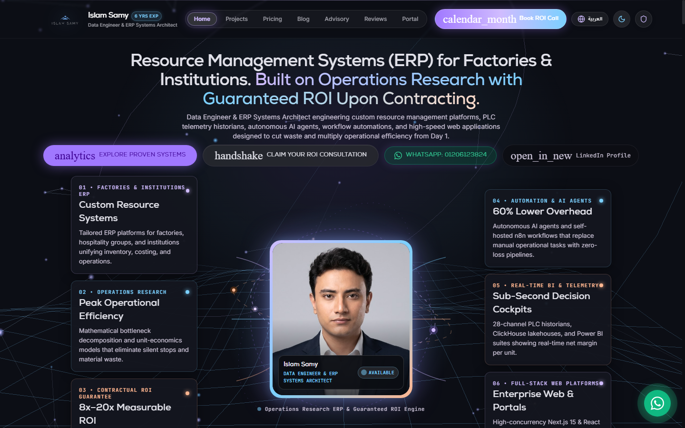

- **Purpose:** Immediately positions the platform around **Operations-Research-driven ERP Systems for Factories & Institutions** with a contract-backed ROI guarantee.
- **Functionality:** Features a 3D orbital core (`Hero3DOrbit`), 6 interactive `TiltCard` capability pillars (Custom Resource Systems, Operations Research, Contractual ROI, AI Agents & Automation, Real-Time PLC/BI Telemetry, and Full-Stack Web Platforms), live Cairo clock telemetry, bilingual EN/AR toggle, and direct WhatsApp/Consultation CTAs.
- **Client Financial Value & OR Impact:** Gives factory owners and institutional executives instant clarity on *how* mathematical optimization translates into lower unit costs and higher throughput—converting skeptical visitors into 48-hour diagnostic requests.

---

### 2. Homepage — Operations Research & Guaranteed ROI Section (`/#operations-research`)
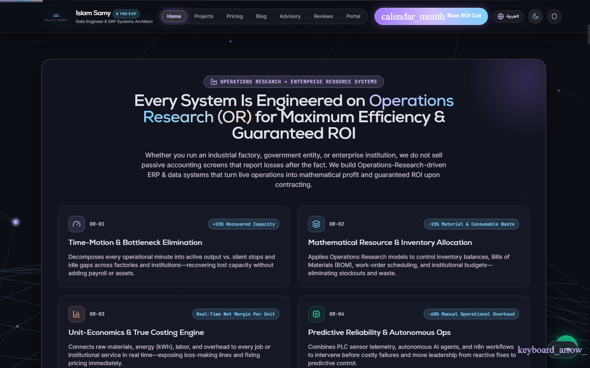

- **Purpose:** Explains the scientific and mathematical methodology behind every system built for factories, hospitality groups, and government/enterprise institutions.
- **Functionality:** Presents the 4 OR Pillars (`OR-01` through `OR-04`) alongside a **Contract-Backed Guaranteed ROI** panel detailing the 48-hour baseline diagnostic, written KPI milestones, 100% IP ownership under NDA, and target **8x–20x ROI** benchmark.
- **Client Financial Value & OR Impact:** De-risks the buying decision for CFOs and plant directors by shifting the engagement from "buying software" to "investing in a system that pays for itself from Month 1."

---

### 3. Homepage — Interactive Project Cards Grid with Importance Arrangement (`/#project-cards`)
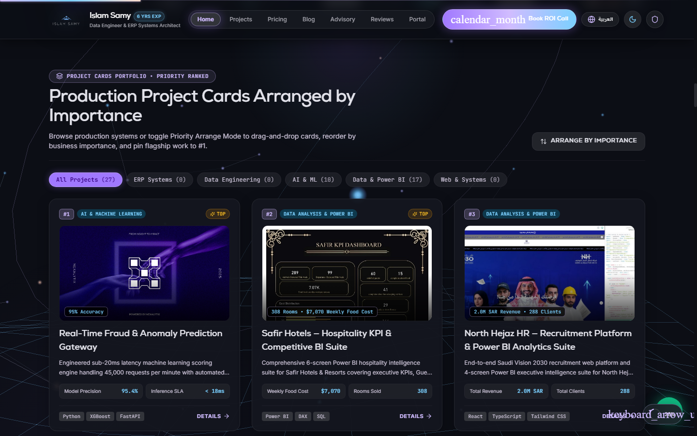

- **Purpose:** Displays production systems as scannable, priority-ranked project cards that can be dynamically ordered by business importance.
- **Functionality:** 3-column responsive grid with category filters (`ERP Systems`, `Data Engineering`, `AI & ML`, `Data & Power BI`, `Web & Systems`), priority rank badges (`#1`, `#2`, `#3`…), and an interactive **Arrange by Importance** mode supporting **drag-and-drop**, **Pin to #1**, **Move Up/Down**, and persistent order synced with `/admin/projects` and Supabase.
- **Client Financial Value & OR Impact:** Highlights the highest-ROI, highest-relevance systems (such as **WireCut OS** at `#1`) first so decision-makers immediately see proof of savings in their exact industry.

---

### 4. Production Projects Gallery (`/projects`)
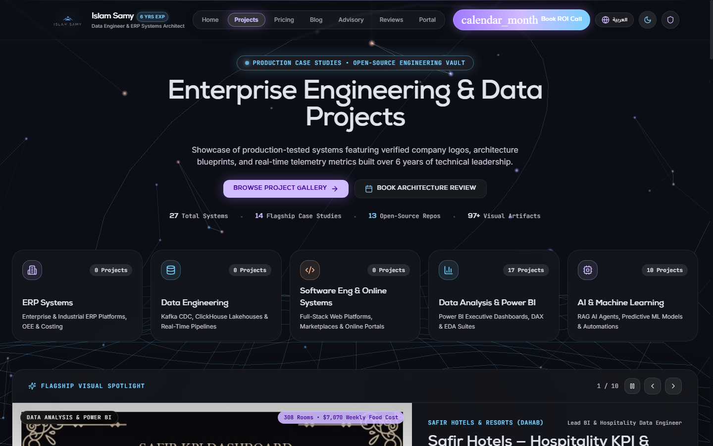

- **Purpose:** Full searchable portfolio catalog of 40+ production systems, ERP deployments, Power BI suites, and AI/ML pipelines.
- **Functionality:** Multi-category filtering, instant keyword search across titles/clients/tech stacks, grid/list layout toggles, interactive `ArchitectureModal` previews, and direct links to deep-dive case studies.
- **Client Financial Value & OR Impact:** Demonstrates cross-industry repeatability of Operations Research and data engineering—proving that the same mathematical rigor scales from marble factories to 14-property hotel chains and FinTech fraud gateways.

---

### 5. Case Study Deep Dive — WireCut OS (`/projects/wirecut-os-marble-erp`)
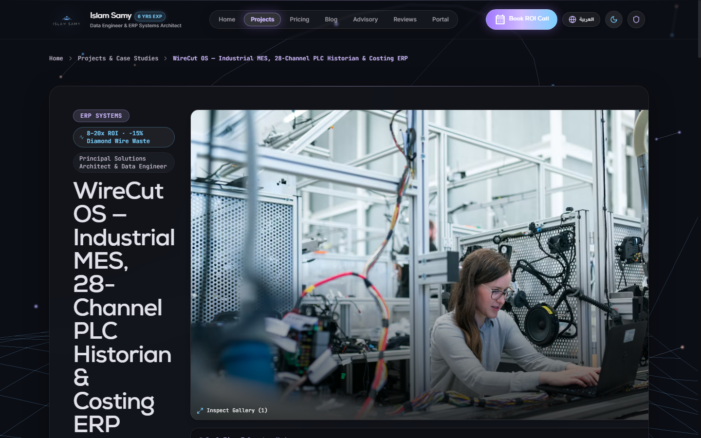

- **Purpose:** Full technical and financial case study of **WireCut OS**—an Industrial MES, 28-Channel PLC Telemetry Historian, and Costing ERP for Multi-Wire Diamond Saws in marble and granite factories.
- **Functionality:** Documents the exact problem, OR-based solution, architectural trade-offs, system data flow, 4 implementation modules, and quantified outcome metrics.
- **Client Financial Value & OR Impact:**
  - **8% – 15% Diamond Wire Savings:** 15,000–35,000 EGP/month (Egypt) or $500–$1,200/month (GCC) per saw.
  - **10% – 15% Uptime Recovery:** +150–300 m²/month extra output with zero added fixed overhead.
  - **8x – 20x ROI:** Pays for itself by optimizing just 1–2 blocks per month while preventing 50,000–200,000 EGP catastrophic failures.

---

### 6. Engineering Blog & Technical Proposals Hub (`/blog`)
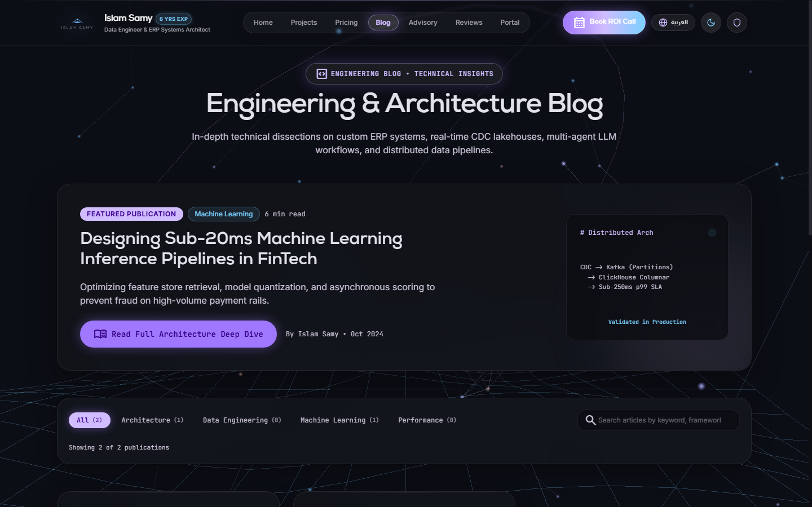

- **Purpose:** Publishes authoritative technical blueprints, commercial proposals, and Operations Research guides in both English and Arabic.
- **Functionality:** Category filter pills (`Architecture`, `Data Engineering`, `Machine Learning`, `Performance`), keyword search, featured proposal spotlight, and instant modal reader or dedicated article pages.
- **Client Financial Value & OR Impact:** Educates clients on unit economics, hidden downtime costs, and compounding institutional memory (Months 1 to 6+), establishing deep domain trust before a sales call even begins.

---

### 7. Blog Article & Proposal Reader (`/blog/wirecut-os-marble-granite-erp-operations-research`)
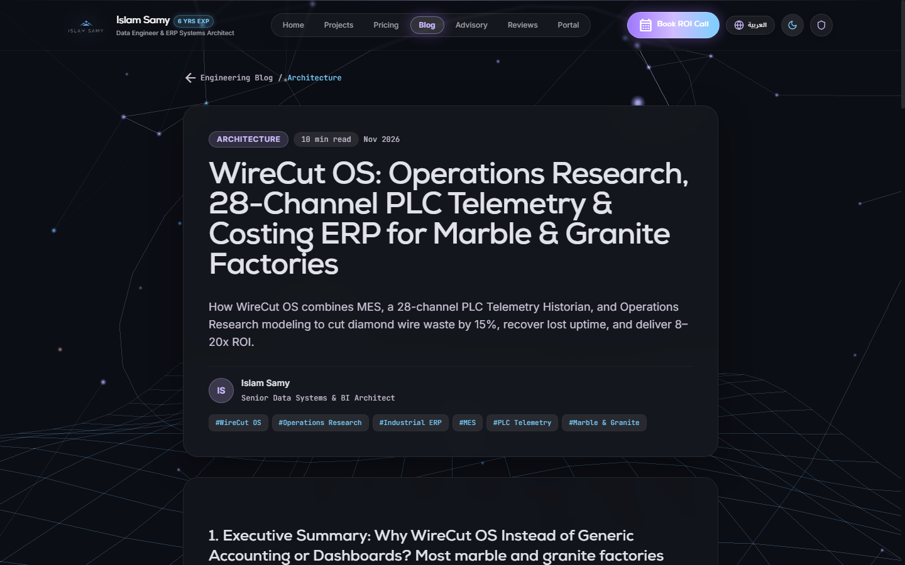

- **Purpose:** Presents the complete WireCut OS technical and commercial proposal—including OR formulas, plant module breakdowns, compounding ROI table, regional pricing tiers (Egypt, GCC, International), and 4-week rollout plan.
- **Functionality:** Powered by `ArticleMarkdownRenderer` supporting responsive Markdown tables, callout blockquotes, multi-level headings, inline math/code badges, syntax-highlighted SQL/code blocks, and seamless bilingual AR/EN switching.
- **Client Financial Value & OR Impact:** Functions as a self-serve executive proposal that plant owners can review with their finance and operations teams, culminating in the **48-Hour Complimentary Diagnostic Offer**.

---

### 8. Transparent Pricing & Engagement Models (`/pricing`)
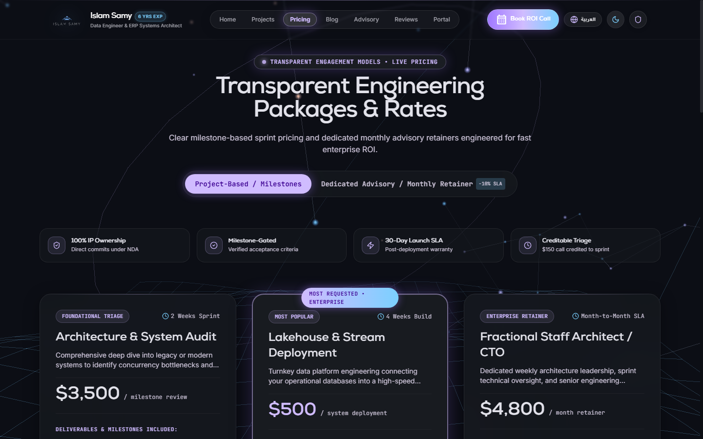

- **Purpose:** Eliminates pricing ambiguity by presenting milestone-gated build packages, monthly retainers, and a live consultation estimator.
- **Functionality:** Milestone vs. Retainer billing toggle, interactive **Custom Advisory Calculator** (hours/week × duration), clear deliverables per tier, and an executive FAQ addressing IP ownership, NDA, and payment milestones.
- **Client Financial Value & OR Impact:** Ties every dollar invested to verified sprint milestones and written ROI criteria—ensuring clients never pay for unverified engineering hours.

---

### 9. Consultation & Package Booking Portal (`/book`)
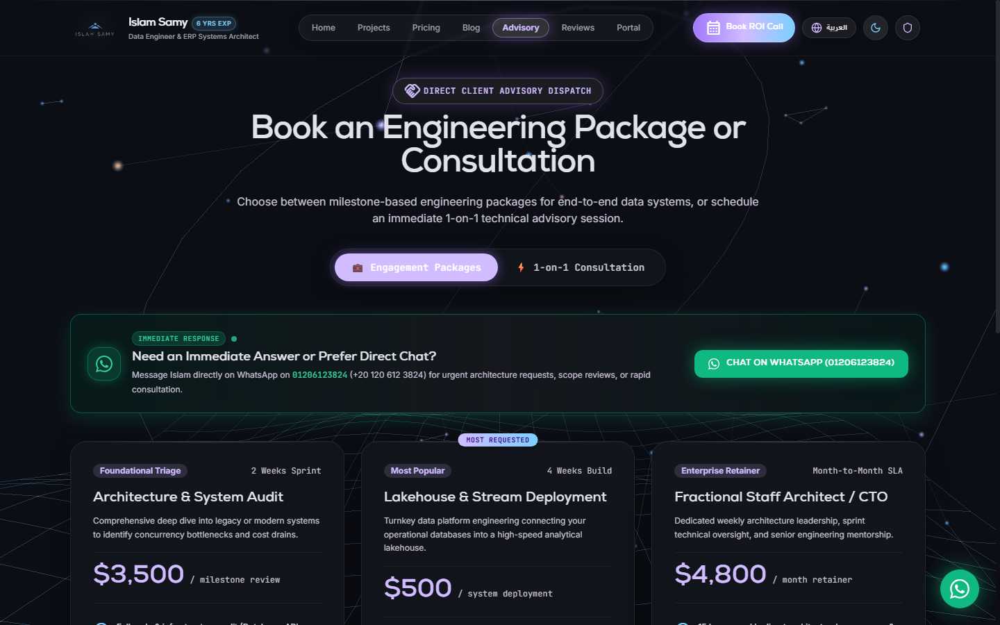

- **Purpose:** Frictionless conversion funnel allowing clients to select an engineering sprint package or schedule a 1-on-1 ROI & architecture diagnostic session.
- **Functionality:** Dual-tab booking flow (`Packages` vs. `1-on-1 Consultation`), timezone-aware slot selection (Cairo EET, London GMT, New York EST, Dubai GST), instant reservation confirmation code, and automatic sync to `/admin/reservations` and `/admin/crm`.
- **Client Financial Value & OR Impact:** Replaces fragmented email back-and-forth with immediate scheduling for the 48-hour operational diagnostic—accelerating time-to-value and ROI realization.

---

### 10. Verified Client Reviews & Endorsements (`/reviews`)
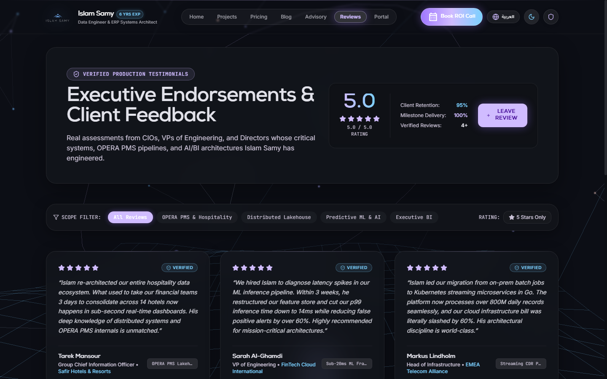

- **Purpose:** Social proof from plant directors, CTOs, and hospitality executives validating system reliability, delivery speed, and financial impact.
- **Functionality:** Overall rating telemetry, scope filters (`Enterprise ERP`, `BI & Analytics`, `Automations`), verified review badges, and an interactive modal for clients to submit new reviews.
- **Client Financial Value & OR Impact:** Confirms real-world post-deployment retention (95%+) and verifiable cost/latency improvements across multiple industries.

---

### 11. Client Reservation Portal (`/my-bookings`)
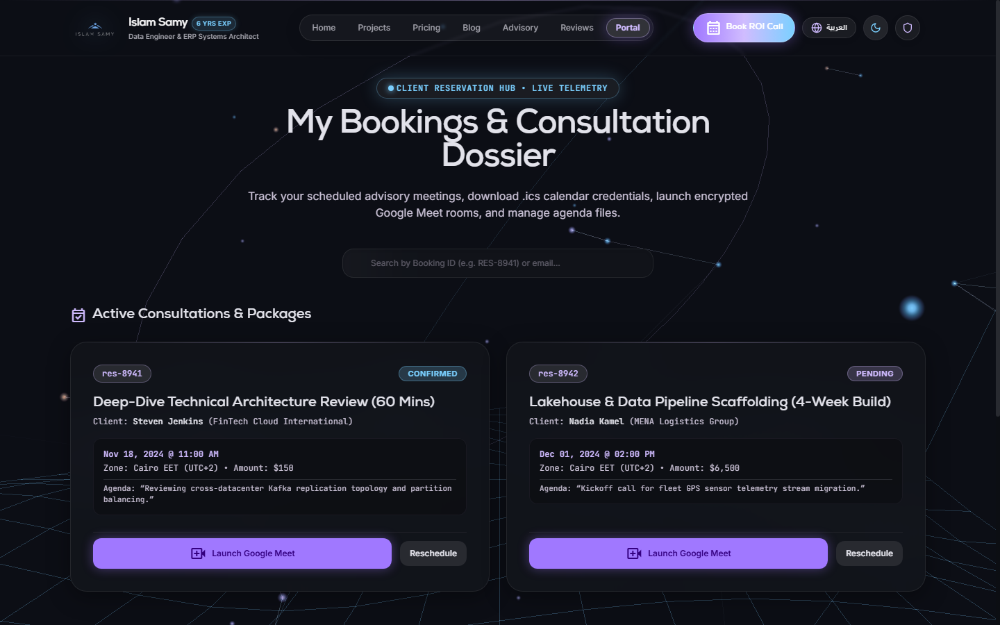

- **Purpose:** Self-service portal where clients track active and past consultations, launch meeting links, or reschedule sessions without contacting support.
- **Functionality:** Lookup by booking ID or work email, active/past tabs, interactive reschedule dialog, and `.ics` calendar export.
- **Client Financial Value & OR Impact:** Demonstrates the same automated, zero-friction operational UX that clients receive inside their own custom ERP and web portals.

---

### 12. Admin Command Center & 8-Module CMS/CRM (`/admin/login` → `/admin/*`)
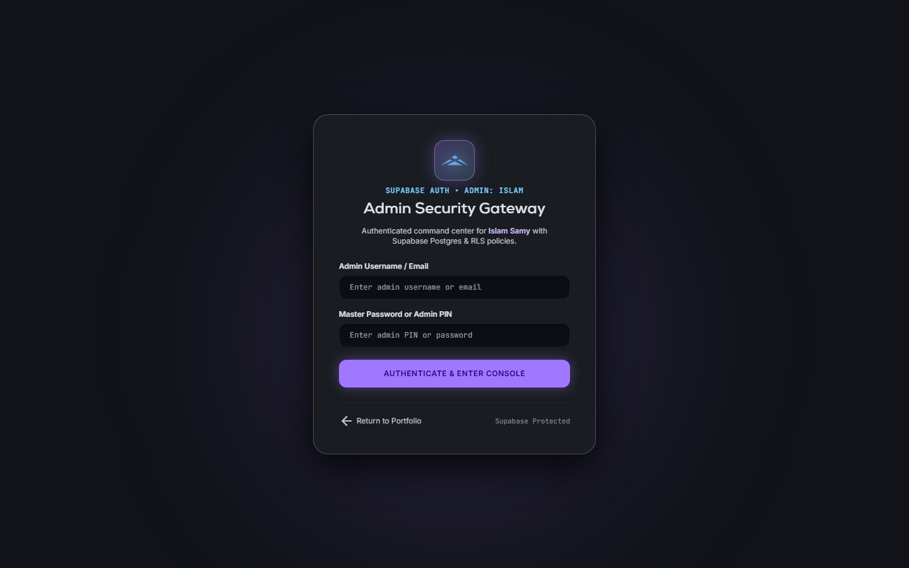

- **Purpose:** Protected administration suite to manage leads, reservations, projects (including priority `#rank` ordering), blog proposals, pricing, certifications, experience, and reviews.
- **Functionality:** Supabase-authenticated admin portal (`/admin/crm`, `/admin/reservations`, `/admin/projects`, `/admin/blog`, `/admin/pricing`, `/admin/certifications`, `/admin/experience`, `/admin/reviews`) backed by `/api/admin/mutate` and `/api/admin/upload`.
- **Client Financial Value & OR Impact:** Serves as a live reference implementation of the exact RBAC, auditability, and operational control panels engineered for client organizations
| Lint | `npm run lint` | Run Next.js ESLint |
| Test | `npm test` | Execute custom test runner (`node tests/runner.mjs`) |
