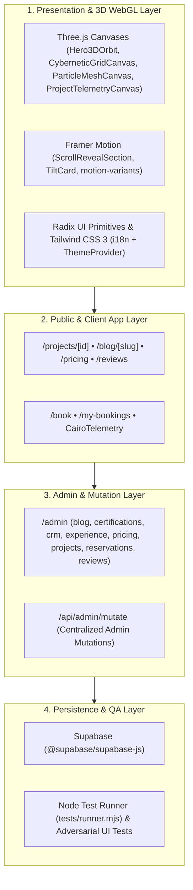

# Islam Samy — Interactive 3D Portfolio, Booking Engine & CRM Platform

A full-stack Next.js 15, React 19, Three.js, Framer Motion, and Supabase platform combining an interactive 3D engineering showcase with a client service booking workflow, technical blog, pricing engine, and private CRM admin suite.

---

## 1. Executive Summary & Purpose
`ISLAMSAMYPROTOFILIO` (`islam-samy-portfolio`) is engineered as a conversion-oriented personal brand and consulting platform. Rather than a static resume, it demonstrates live technical depth via custom Three.js WebGL canvases while giving prospective clients a frictionless path to review pricing, inspect architecture case studies, and schedule consultations—all managed internally through `/admin`.

---

## 2. System Architecture & Layers



| Layer | Responsibility | Key Files |
| :--- | :--- | :--- |
| **WebGL & Motion Layer** | GPU-accelerated 3D scenes, tilt physics, and reduced-motion-aware animations | `src/components/canvas/{Hero3DOrbit,CyberneticGridCanvas,ParticleMeshCanvas,ProjectTelemetryCanvas,ThreeBackgroundCanvas}.tsx`, `src/components/ui/TiltCard.tsx` |
| **UI & Design System Layer** | Accessible Radix UI primitives, dark/light theming, mobile drawer, scroll progress, and telemetry header | `src/components/ui/*`, `src/components/navigation/{SiteHeader,SiteFooter,MobileNavDrawer,CairoTelemetry}.tsx` |
| **Public Showcase & Booking Layer** | Project deep dives with `ArchitectureModal`, blog, pricing calculator/tiers, and client booking tracking | `src/app/{projects,blog,pricing,reviews,book,my-bookings}/page.tsx` |
| **Admin & CRM Layer** | Full-featured CMS, lead CRM, and reservation management routed through a unified mutation API | `src/app/admin/{blog,certifications,crm,experience,pricing,projects,reservations,reviews}/page.tsx`, `src/app/api/admin/mutate/route.ts` |
| **SEO & Metadata Layer** | Dynamic `sitemap.ts`, `robots.ts`, `manifest.ts`, `error.tsx`, and `loading.tsx` | `src/app/{sitemap,robots,manifest}.ts` |

---

## 3. Core Functionality & Modules
- **Interactive Portfolio (`/projects`, `/projects/[id]`)**: Filterable case studies featuring `ArchitectureModal.tsx` and live telemetry visuals.
- **Technical Blog (`/blog`, `/blog/[slug]`)**: Full article rendering (`ArticleCard`, `BlogPostClient`).
- **Consultation & Service Booking (`/book`, `/my-bookings`, `/pricing`)**: Transparent service tiers and self-service booking/status lookup.
- **Credibility Sections**: `CertificationsSection`, `ClientReviewsSection`, `ExperienceTimelineSection`, `TechArsenalSection`.
- **Admin CRM & CMS (`/admin`)**: Authenticated portal (`/admin/login`) managing 8 domains: Blog, Certifications, CRM leads, Experience, Pricing, Projects, Reservations, and Reviews.

---

## 4. Project Structure
```text
├── src/
│   ├── app/
│   │   ├── admin/          # 8-module Admin CMS & CRM
│   │   ├── api/admin/mutate/ # Server-side admin mutation handler
│   │   ├── blog/           # Technical articles
│   │   ├── book/           # Client consultation booking
│   │   ├── my-bookings/    # Client booking tracker
│   │   ├── pricing/        # Service packages
│   │   ├── projects/       # Case studies & [id] detail view
│   │   └── reviews/        # Verified client testimonials
│   ├── components/         # canvas/, animation/, home/, navigation/, projects/, ui/
│   ├── context/            # Application state providers
│   ├── data/               # Structured portfolio datasets
│   ├── hooks/              # Custom React hooks
│   ├── i18n/               # Localization support
│   └── lib/                # Supabase & helper utilities
├── docs/                   # Technical docs (PROJECT.md, TEST_INFRA.md)
└── tests/                  # Automated test runner & adversarial UI specs
```

---

## 5. Getting Started

```bash
git clone https://github.com/islamsamyy/ISLAMSAMYPROTOFILIO.git
cd ISLAMSAMYPROTOFILIO
npm install
cp .env.example .env.local
```

| Script | Description |
| :--- | :--- |
| `npm run dev` | Start Next.js 15 dev server |
| `npm run build` | Production build |
| `npm run start` | Start production server |
| `npm run lint` | Run ESLint |
| `npm test` | Run test suite (`node tests/runner.mjs`) |

---

## 6. Business Value & Growth Opportunities
- **Productized Consulting Funnel**: Converts portfolio visitors directly into paid discovery calls via `/pricing` -> `/book` -> `/admin/crm` without relying on third-party tools like Calendly or HubSpot.
- **Stripe Deposit Integration**: Add upfront deposit collection on `/book` to eliminate no-shows for paid architecture audits.
- **White-Label Agency Template**: License the codebase (with its 3D canvases + 8-module Admin CRM) as a premium Next.js boilerplate for senior engineers, consultants, and boutique agencies.
- **Automated Lead Nurture**: Connect `/admin/crm` to Resend/email sequences when a reservation or inquiry is created.
