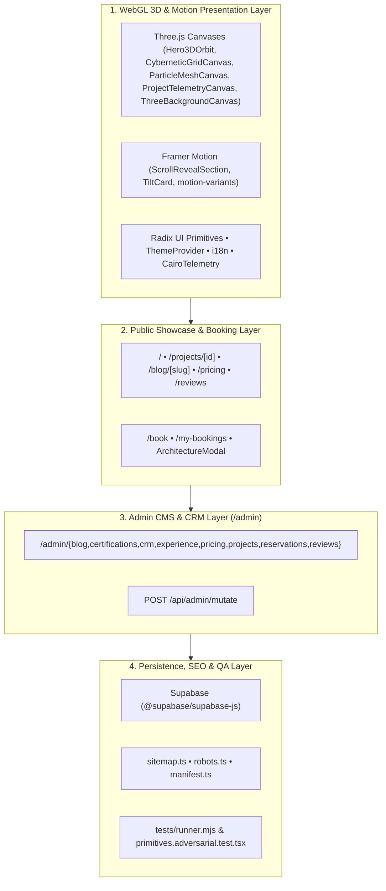

# Islam Samy — 3D Interactive Engineering Portfolio, Booking & CRM Platform

<p align="center">
  
</p>

## Table of Contents
- [Executive Summary & Business Utility](#executive-summary--business-utility)
- [Visual Showcase (UI & Dashboards)](#visual-showcase-ui--dashboards)
- [System Architecture & Layers](#system-architecture--layers)
- [Data Model & Content Architecture](#data-model--content-architecture)
- [Application Modules & API Endpoints](#application-modules--api-endpoints)
- [Getting Started & Scripts](#getting-started--scripts)
- [Business Value, ROI & Growth Opportunities](#business-value-roi--growth-opportunities)

---

## Executive Summary & Business Utility
`ISLAMSAMYPROTOFILIO` (`islam-samy-portfolio`) is a full-stack Next.js 15, React 19, Three.js, Framer Motion, and Supabase platform engineered to serve as both a **high-impact technical showcase** and an **autonomous client acquisition & CRM system**. Prospective clients explore interactive 3D architecture case studies, verified reviews, certifications, and transparent service pricing, then book consultations directly via `/book`—while the owner manages leads, reservations, blog content, and portfolio items through an 8-module `/admin` suite.

---

## Visual Showcase (UI & Dashboards)
Brand identity and visual assets stored in `public/images/` and `src/app/`:

| Brand Mark | Primary Logo | Founder Portrait |
| :---: | :---: | :---: |
|  |  |  |

---

## System Architecture & Layers



| Layer | Responsibility | Key Files |
| :--- | :--- | :--- |
| **3D WebGL & Motion Layer** | GPU-accelerated Three.js backgrounds/orbits, interactive 3D tilt cards, and reduced-motion-safe animations | `src/components/canvas/*.tsx`, `src/components/animation/*.tsx`, `src/components/ui/TiltCard.tsx` |
| **Design System & Navigation** | Radix UI primitives, dark/light themes, Cairo live telemetry widget, mobile drawer, and scroll progress | `src/components/ui/*`, `src/components/navigation/{SiteHeader,SiteFooter,CairoTelemetry,MobileNavDrawer,ScrollProgress}.tsx` |
| **Public Funnel & Booking Layer** | Project case studies with `ArchitectureModal`, technical blog, service tiers, and self-service booking tracker | `src/app/{projects,blog,pricing,reviews,book,my-bookings}/page.tsx` |
| **Admin CMS & Lead CRM Layer** | Protected 8-module administration panel routed through a unified server mutation endpoint | `src/app/admin/*/page.tsx`, `src/app/api/admin/mutate/route.ts` |
| **SEO & Testing Layer** | App Router `sitemap.ts`, `robots.ts`, `manifest.ts`, plus adversarial primitive tests | `src/app/{sitemap,robots,manifest}.ts`, `tests/runner.mjs` |

---

## Data Model & Content Architecture
- **Dynamic Entities (Supabase)**: Projects, Blog Articles, Certifications, Experience Timeline, Pricing Packages, Client Reservations/Bookings, CRM Leads, and Client Reviews.
- **Static Fallbacks & Localization (`src/data/`, `src/i18n/`, `src/context/`)**: Structured datasets and context providers ensure fast initial rendering and multi-language readiness.

---

## Application Modules & API Endpoints

### Public Routes
- `/` — Home with `CertificationsSection`, `ClientReviewsSection`, `ExperienceTimelineSection`, and `TechArsenalSection`
- `/projects` & `/projects/[id]` — Case study showcase (`ProjectDetailClient.tsx`, `ArchitectureModal.tsx`)
- `/blog` & `/blog/[slug]` — Technical engineering articles (`ArticleCard.tsx`, `BlogPostClient.tsx`)
- `/pricing`, `/reviews`, `/book`, `/my-bookings` — Commercialization & booking management

### Admin Suite (`/admin`)
- `/admin/login` — Admin authentication
- `/admin/crm` — Lead & client pipeline management
- `/admin/reservations` — Consultation booking approvals & scheduling
- `/admin/projects`, `/admin/blog`, `/admin/certifications`, `/admin/experience`, `/admin/pricing`, `/admin/reviews` — Full portfolio CMS

### API Endpoints
| Endpoint | Purpose |
| :--- | :--- |
| `/api/admin/mutate` (`src/app/api/admin/mutate/route.ts`) | Centralized server-side mutation handler for all Admin CMS & CRM CRUD actions |

---

## Getting Started & Scripts

```bash
git clone https://github.com/islamsamyy/ISLAMSAMYPROTOFILIO.git
cd ISLAMSAMYPROTOFILIO
npm install
cp .env.example .env.local
```

| Script | Command | Description |
| :--- | :--- | :--- |
| Dev | `npm run dev` | Start Next.js 15 dev server |
| Build | `npm run build` | Production build |
| Start | `npm run start` | Start production server |
| Lint | `npm run lint` | Run Next.js ESLint |
| Test | `npm test` | Execute custom test runner (`node tests/runner.mjs`) |

---

## Business Value, ROI & Growth Opportunities
- **Zero-Friction Consulting Funnel**: Converts technical credibility directly into booked consultations (`/pricing` -> `/book` -> `/admin/crm`) without paying for Calendly, HubSpot, or Webflow.
- **Paid Discovery Deposits**: Adding Stripe Checkout to `/book` converts free calls into paid architecture reviews and eliminates calendar no-shows.
- **Productized Boilerplate Licensing**: License this 3D + 8-module CRM Next.js codebase as a premium starter kit for senior engineers, agencies, and fractional CTOs.
