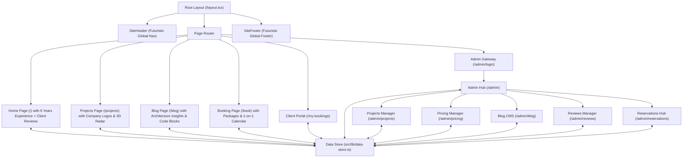

# Islam Samy Executive Engineering Platform — Futuristic 3D Architecture & Implementation Plan

> **Role & Executive Context:** Designed for **Islam Samy**, Senior Software Engineer & Solutions Architect with **6 Years** of high-impact production engineering experience in Distributed Systems, Real-Time Lakehouses, AI/Machine Learning, and Enterprise Business Intelligence.
>
> **Design Vision:** Futuristic, dark cybernetic aesthetic aligned 100% with the existing Home page (Material Design 3 tokens, `#111319` background, `#d0bcff` violet, `#7bd0ff` cyan, `#ffb690` amber, glassmorphism `backdrop-blur-md`, subtle architectural grid), augmented with **Interactive 3D Canvas Visualizers**, **Framer Motion spring physics & micro-interactions**, and **shadcn/Radix UI** primitives.

---

## 1. Goal Description

Deliver a cohesive, high-performance web platform featuring:
1. **Executive Portfolio (`/`)**: 
   - 6 years of verified engineering experience.
   - Futuristic 3D orbiting portrait core, telemetry metrics, and ambient particle field.
   - Filterable technology radar grid with animated skill progress bars.
   - Professional experience timeline (OPERA PMS, Safir Hotels, FinTech ML pipelines).
   - **Client Reviews & Verified Endorsements Section**: Highlighting enterprise client testimonials, company logos, ratings, and verified project deliveries.
   - Interactive consultation & contact dispatch.
2. **Restructured Global Shared Navigation (`SiteHeader` & `SiteFooter`)**:
   - Cybernetic glassmorphism header with active route glowing indicator.
   - Live timezone telemetry (`Cairo GMT+2 • Live Cal Sync`).
   - Links: `Home (/)`, `Projects (/projects)`, `Blog (/blog)`, `Book (/book)` (Packages & Consultations), `Reviews (/reviews` or `#reviews`), `My Bookings (/my-bookings)`, and Admin gateway.
3. **Projects & Case Studies with Company Logos (`/projects`)**:
   - Production case studies featuring **Company Logos** (Safir Hotels & Resorts, FinTech Cloud, Telecom Egypt, TransGlobal Logistics).
   - Interactive 3D telemetry canvases (live waveform, holographic radar cylinder).
   - System architecture blueprints, throughput metrics (1.4M msg/sec), and verified artifacts modal.
4. **Engineering Blog & Technical Insights (`/blog`)**:
   - Curated architectural publications with code simulation, syntax highlighting, category tags, search, and reading modal.
5. **Dual Booking Engine (`/book`)**:
   - **Track A — Engagement Packages**: Fixed-scope milestones and monthly fractional CTO retainers with deliverables, pricing, and intake form.
   - **Track B — 1-on-1 Consultation**: Hourly/advisory sessions (30/60 min) with live calendar picker, timezone conversion, and instant `.ics` / Google Meet dispatch.
6. **Client Booking Management Portal (`/my-bookings`)**:
   - Active reservation lookup, Google Meet launchpad, reschedule workflows, and agenda uploads.
7. **Complete Admin Command Center (`/admin`)**:
   - `/admin/login`: Hardware security key / PIN auth gateway.
   - `/admin`: Command Center overview with KPIs, live activity telemetry, and system stats.
   - `/admin/projects`: Add, edit, and delete projects with company logos, tech stacks, and metrics.
   - `/admin/pricing`: Control package tiers, deliverables, hourly rates, and retainer terms.
   - `/admin/blog`: Author, edit, publish, tag, and delete engineering articles.
   - `/admin/reviews`: Manage client reviews, ratings, company names, and endorsement quotes.
   - `/admin/reservations`: Review, approve, reschedule, or cancel bookings, with CSV export.
8. **Dynamic Reactive Data Layer (`src/lib/data-store.ts`)**:
   - Synchronizes Admin edits directly to public pages in real time via localStorage + in-memory store with seeded production data.

---

## 2. User Review Required

> [!IMPORTANT]
> **Experience Milestone:**  
> Updated from 10 to **6 Years** across the hero status pill, telemetry badges, timeline milestones, and about summary.
>
> **Client Reviews / Testimonials Section:**  
> Integrated both on the public site (with company logos, ratings, and project tags) and into the Admin Dashboard (`/admin/reviews`) so you can add, edit, or feature reviews anytime.

> [!TIP]
> **Futuristic 3D & Framer Motion Stack:**  
> - **Canvas 3D:** Rotating holographic rings, telemetry waveform, radar blip canvas.  
> - **Framer Motion:** Spring transitions, glowing border hover effects, stagger fade-ins, animated tabs.  
> - **shadcn/Radix UI:** Accessible dialogs, tabs, dropdowns, and buttons styled with the Stitch dark palette.

---

## 3. Architecture & Proposed File Structure



### Proposed Directory Layout

```text
islamweb/src/
├── app/
│   ├── layout.tsx                     # Root shell with Google Fonts & Material Symbols
│   ├── globals.css                    # Tailwind design system tokens & glassmorphism
│   ├── page.tsx                       # Home: 6-Year Portfolio + Client Reviews
│   ├── projects/
│   │   └── page.tsx                   # Projects catalog with Company Logos & 3D Radar
│   ├── blog/
│   │   └── page.tsx                   # Engineering Blog listing & reading modal
│   ├── book/
│   │   └── page.tsx                   # Dual Booking: Packages & 1-on-1 Consultation
│   ├── my-bookings/
│   │   └── page.tsx                   # Client reservation tracking portal
│   └── admin/
│       ├── page.tsx                   # Admin Command Center Overview
│       ├── login/
│       │   └── page.tsx               # Security Gateway & PIN login
│       ├── projects/
│       │   └── page.tsx               # Project & Company Logo Manager (CRUD)
│       ├── pricing/
│       │   └── page.tsx               # Pricing & Packages Manager (CRUD)
│       ├── blog/
│       │   └── page.tsx               # Blog Articles CMS (CRUD)
│       ├── reviews/
│       │   └── page.tsx               # Client Reviews & Testimonials Manager (CRUD)
│       └── reservations/
│           └── page.tsx               # Reservations Operations & Status Hub
│
├── components/
│   ├── navigation/
│   │   ├── SiteHeader.tsx             # Shared responsive futuristic header
│   │   ├── SiteFooter.tsx             # Shared futuristic cybernetic footer
│   │   └── AdminNav.tsx               # Dedicated Admin navigation strip
│   ├── home/
│   │   └── ClientReviewsSection.tsx   # Futuristic Client Reviews with Company Logos
│   ├── projects/
│   │   ├── ProjectCard.tsx            # Project card with company logo, tech tags, metrics
│   │   └── ArchitectureModal.tsx      # System architecture blueprint modal
│   ├── blog/
│   │   └── ArticleCard.tsx            # Blog card with read time, category, author badge
│   ├── booking/
│   │   ├── PackageSelector.tsx        # Engagement Package tiers & deliverables
│   │   ├── ConsultationPicker.tsx     # Calendar date/time slot picker
│   │   └── BookingSummaryModal.tsx    # Confirmation & ICS calendar invite dispatch
│   └── ui/
│       ├── badge.tsx
│       ├── button.tsx
│       ├── dialog.tsx
│       └── tabs.tsx
│
├── data/
│   ├── seedProjects.ts                # Default 6-year enterprise projects with company logos
│   ├── seedArticles.ts                # Default deep-dive architecture articles
│   ├── seedPricing.ts                 # Default packages & consultation rates
│   ├── seedReviews.ts                 # Default client reviews with company logos & ratings
│   └── seedReservations.ts            # Default booking calendar slots & requests
│
└── lib/
    ├── data-store.ts                  # Reactive localStorage + state management store
    ├── hooks.ts                       # useProjects, useBlog, usePricing, useReviews, useBookings
    └── utils.ts                       # Classnames merge & formatting helpers
```

---

## 4. Component Details & Specifications

### 4.1 Global Shared Navigation (`SiteHeader.tsx`)
- Monogram: **IS.** with glowing violet-cyan accent.
- Nav Items:
  - `Home` (`/`)
  - `Projects` (`/projects`) — Badged with company logos indicator
  - `Blog` (`/blog`) — Badged with "New"
  - `Book` (`/book`) — Packages & Consultations
  - `Reviews` (`/#reviews`) — Jump to client testimonials
  - `Client Portal` (`/my-bookings`)
- Right actions:
  - Timezone chip: `Cairo GMT+2 • Live Cal Sync`
  - "Book Now" gradient pill button -> jumps directly to `/book`
  - Admin Gateway icon link -> `/admin`

### 4.2 Home Page Updates (`/`)
- Updated experience baseline: **6 Years** of verified software engineering & solutions architecture.
- Added **Client Reviews & Testimonials Section**:
  - Cards with 5-star ratings, verified quote, client avatar, name, executive title, company name, and company logo.
  - Featured clients: Safir Hotels & Resorts, FinTech Cloud Group, Global Logistics Network, EMEA Telecom.
  - Animated carousel / grid with Framer Motion spring hover glow.

### 4.3 Projects & Case Studies with Company Logos (`/projects`)
- Filter categories: `All Projects`, `Distributed Systems`, `Lakehouse & BI`, `AI & Machine Learning`, `Cloud Native`.
- Project Card Elements:
  - **Company Logo Badge**: High-contrast, brand-accented badge (Safir Hotels & Resorts, FinTech Cloud, Telecom Egypt, TransGlobal Logistics).
  - Client / Industry label (e.g., *Hospitality Enterprise*, *Financial Services*, *Logistics Telemetry*).
  - Role: *Lead Architect / Principal Engineer*.
  - Metric chips: *1.4M msg/sec*, *95% Accuracy*, *60% Cost Reduction*, *OPERA PMS Integration*.
  - Tech badges: *Kafka, ClickHouse, Go, Python, React, Next.js, OPERA PMS, Kubernetes*.
  - Action buttons: "Architecture Blueprint" modal + "Case Study Breakdown".

### 4.4 Engineering Blog & Insights (`/blog`)
- Hero with search input and category pills (`Architecture`, `Data Pipelines`, `Machine Learning`, `Performance`).
- Featured Deep Dive: *Building a Zero-Downtime Real-Time Lakehouse for Hospitality Enterprises*.
- Grid of technical articles with read time, published date, key takeaways, and code snippets.
- Interactive reader modal for complete articles.

### 4.5 Dual Booking Engine (`/book`)
- **Toggle switch**: `💼 Engagement Packages` vs `⚡ 1-on-1 Consultation Call`.
- **Packages Track**:
  - Tier 1: *Technical Architecture Review (2-Week Sprint)* — Fixed scope, security & scalability audit.
  - Tier 2: *Lakehouse & Data Pipeline Scaffolding (4-Week Build)* — End-to-end data lake, ETL/ELT pipelines, BI dashboards.
  - Tier 3: *Fractional Staff Architect / CTO (Monthly Retainer)* — Weekly sprint guidance, architecture governance, high-concurrency reviews.
- **Consultation Track**:
  - 30-min Strategy Triage or 60-min Deep Architecture Review.
  - Interactive calendar month view with live slot availability.
  - Timezone selector with automatic local time detection.
  - Intake questionnaire (Company, System URL, Architecture Challenge).
  - Confirmation dispatch with downloadable `.ics` calendar file and Google Meet link.

### 4.6 Admin Command Center (`/admin`)
- Accessible via secure gateway (`/admin/login`).
- **Tab 1: Overview**: System telemetry, total revenue pipeline, booking requests, published count.
- **Tab 2: Projects Manager (`/admin/projects`)**:
  - Form to add/edit project: Title, Company Name, Company Logo URL, Client Category, Role, Tech Stack, Metrics, Case Study Text.
  - Delete or reorder projects.
- **Tab 3: Pricing & Packages Manager (`/admin/pricing`)**:
  - Update prices and deliverable bullets for all 3 packages.
  - Update consultation hourly/session fees.
- **Tab 4: Blog CMS (`/admin/blog`)**:
  - Full editor: Title, Slug, Category, Excerpt, Content (Markdown supported), Read Time, Cover Image URL.
- **Tab 5: Reviews Manager (`/admin/reviews`)**:
  - Add, edit, or delete client reviews, ratings, company names, and endorsement quotes.
- **Tab 6: Reservations Manager (`/admin/reservations`)**:
  - Filterable table of all client booking inquiries.
  - Status management: `Pending`, `Confirmed`, `Completed`, `Rescheduled`.
  - Direct actions to approve, change times, view client details, or export to CSV.

---

## 5. Verification Plan

### Automated Verification
1. Run `npx tsc --noEmit` to verify type safety across all components and pages.
2. Run `npm run build` to verify Next.js 15 production static generation across all routes:
   - `/`
   - `/projects`
   - `/blog`
   - `/book`
   - `/my-bookings`
   - `/admin`
   - `/admin/login`
   - `/admin/projects`
   - `/admin/pricing`
   - `/admin/blog`
   - `/admin/reviews`
   - `/admin/reservations`

### Manual Verification
1. **Public Site:**
   - Navigate from Home to Projects, Blog, Book, Reviews, and My Bookings via the new `SiteHeader`.
   - Verify company logos display properly with fallback styling on `/projects`.
   - Check the new Client Reviews section on the Home page with ratings and company logos.
   - Switch between Packages and Consultation tabs on `/book` and test the booking flow.
   - Search and filter articles on `/blog`.
2. **Admin Operations:**
   - Log in via `/admin/login`.
   - Add a new Project with a company logo and confirm it appears on `/projects` and `/`.
   - Change a package price in `/admin/pricing` and verify it updates on `/book` and `/`.
   - Add a new blog post in `/admin/blog` and verify it displays on `/blog`.
   - Add/edit a client review in `/admin/reviews` and confirm it updates on Home.
   - View test reservations in `/admin/reservations`.

---

## 6. Execution Tasks

- [ ] **Task 1: Foundation Data Store & Seed Schemas** (`src/lib/data-store.ts`, `src/lib/hooks.ts`, seed data with 6 years experience & company logos)
- [ ] **Task 2: Futuristic Global Navigation & Footer** (`SiteHeader.tsx`, `SiteFooter.tsx`)
- [ ] **Task 3: Client Reviews Section & Home Page Updates** (`ClientReviewsSection.tsx`, update Home with 6 years experience)
- [ ] **Task 4: Projects Page with Company Logos & 3D Canvases** (`src/app/projects/page.tsx`, `ProjectCard.tsx`, `ArchitectureModal.tsx`)
- [ ] **Task 5: Engineering Blog & Technical Insights** (`src/app/blog/page.tsx`, `ArticleCard.tsx`)
- [ ] **Task 6: Dual Booking System — Packages & Consultations** (`src/app/book/page.tsx`, `PackageSelector.tsx`, `ConsultationPicker.tsx`)
- [ ] **Task 7: Client Booking Portal** (`src/app/my-bookings/page.tsx`)
- [ ] **Task 8: Admin Command Center & Security Gateway** (`/admin/login`, `/admin/page.tsx`, `AdminNav.tsx`)
- [ ] **Task 9: Admin Projects & Company Logos Manager** (`/admin/projects/page.tsx`)
- [ ] **Task 10: Admin Pricing & Packages Manager** (`/admin/pricing/page.tsx`)
- [ ] **Task 11: Admin Blog CMS** (`/admin/blog/page.tsx`)
- [ ] **Task 12: Admin Client Reviews Manager** (`/admin/reviews/page.tsx`)
- [ ] **Task 13: Admin Reservations & Bookings Hub** (`/admin/reservations/page.tsx`)
- [ ] **Task 14: Production Build & End-to-End Verification**
